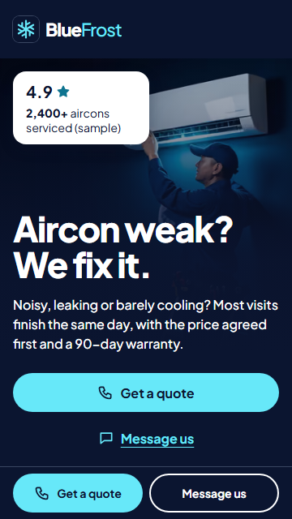
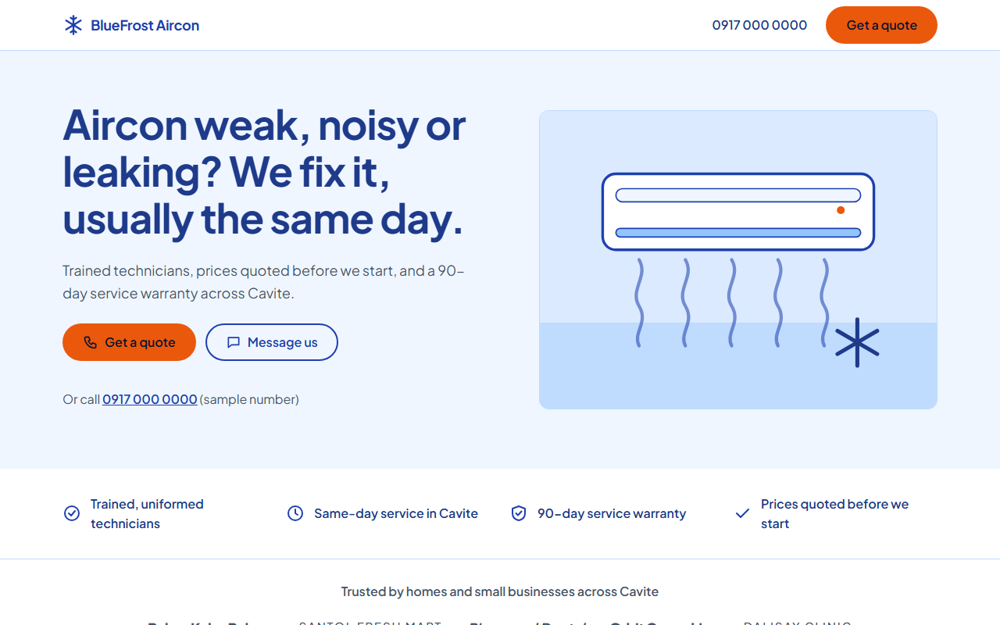

# BlueFrost Aircon landing page

A fast, mobile-first landing page for **BlueFrost Aircon**, a *fictional* aircon cleaning and repair business in Cavite, Philippines. It is a USAD Labs portfolio piece ("Connect. Automate. Accelerate."). All names, numbers, prices and reviews are invented sample data.

One page, 11 sections, one clear "Get a quote" action (a `tel:` link and a placeholder Messenger link). No form, no tracking, **0 client JavaScript**: it works with JS turned off.

## Stack and why

[Astro](https://astro.build) + TypeScript (strict) + scoped CSS. Static HTML out, 0 JS by default, built-in image optimisation, and components plus typed data files that carry over to the next portfolio pages. Full reasoning: [specs/001-landing-page/plan.md](specs/001-landing-page/plan.md).

## Run it

```bash
npm install
npm run dev       # http://localhost:4321
npm run build     # static site in dist/
npm run preview   # serve dist/
```

## Checks

```bash
npm run check                       # TypeScript + Astro diagnostics
npm run build                       # also runs the pricing self-check in src/data/pricing.ts
npx html-validate "dist/**/*.html"  # HTML validity
gitleaks dir . --no-banner --redact # secret scan
```

```bash
npx playwright test                 # browser tests: 360px, JS off, axe, page weight, quote links
SHOTS=1 npx playwright test         # also regenerates the screenshots in docs/
npx lhci autorun                    # Lighthouse CI (slow, so not in the auto gate)
```

Lighthouse mobile (local build, 2026-11-03): performance 97–100, accessibility 100, best practices 100, SEO 100; first load ≈ 70 KB.

## Where things are

- `src/data/` content data: services, prices, reviews, FAQ, stats, sample contacts (the section headings and hero copy are in the components)
- `src/components/` one component per section
- `src/styles/` design tokens and global styles
- `src/assets/hero-placeholder.svg` hero image placeholder (swap steps are in `src/components/Hero.astro`)
- `CREDITS.md` fonts, icons and image credits

## Screenshots





## Planning tools (not in this repo)

Specs were written with [GitHub spec-kit](https://github.com/github/spec-kit) and the design system with [ui-ux-pro-max](https://github.com/nextlevelbuilder/ui-ux-pro-max-skill). Their local tool folders (`.specify/`, `.claude/skills/`) are git-ignored. Re-create them with `specify init --here --integration claude` and by copying the `ui-ux-pro-max` skill folder into `.claude/skills/`.

## License

MIT, see [LICENSE](LICENSE). BlueFrost Aircon is fictional and all content is sample data.
